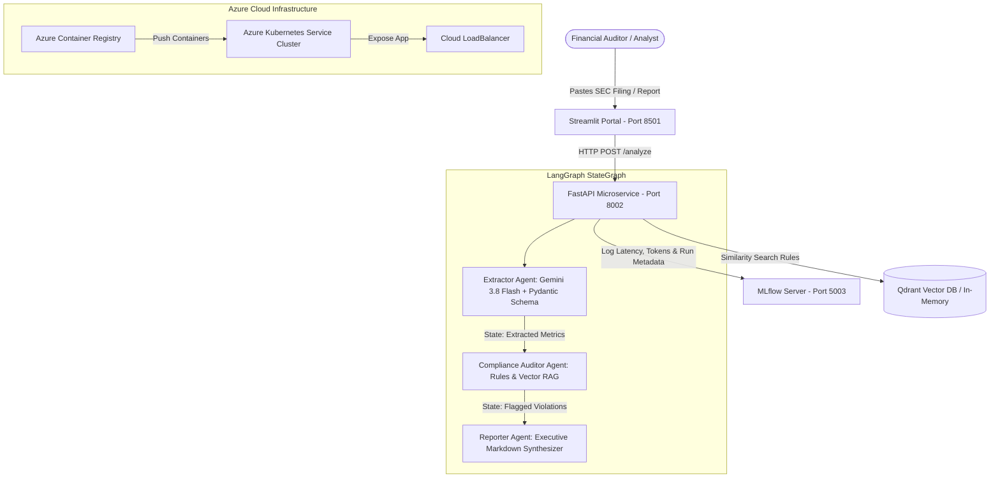

# FinAgent-Ops: Enterprise Multi-Agent Financial Compliance & Audit Engine

[](https://www.python.org/)
[](https://fastapi.tiangolo.com/)
[](https://langchain-ai.github.io/langgraph/)
[](https://mlflow.org/)
[](https://www.docker.com/)
[](https://azure.microsoft.com/en-us/products/kubernetes-service)
[](LICENSE)

**FinAgent-Ops** is an enterprise-grade GenAI financial compliance and document auditing platform. Built with a stateful multi-agent architecture using **LangGraph**, **FastAPI**, **Streamlit**, **Qdrant**, and **MLflow**, it automates the ingestion of unstructured SEC filings and corporate financial disclosures, extracts structured balance-sheet metrics, audits for regulatory non-compliance (such as SEC Item 1A ESG disclosures), and synthesizes executive summary reports.

---

## 🏛️ System Architecture



---

## 💻 Tech Stack & Frameworks

* **Multi-Agent Orchestration:** LangGraph stateful execution graph (`StateGraph`), LangChain Core
* **Large Language Models:** Google GenAI (`gemini-3.8-flash`), Google Generative AI Embeddings (`text-embedding-004`)
* **Structured Data Extraction:** Pydantic v2 validation schema models
* **Vector Store & RAG:** Qdrant Vector DB (`qdrant-client`, `langchain-qdrant`)
* **Backend Microservice:** FastAPI, Uvicorn, Python 3.11
* **Frontend Portal:** Streamlit enterprise portal UI
* **LLMOps & Monitoring:** MLflow tracking server (tracing execution latency, compliance issue count, document character length)
* **DevOps & Cloud Orchestration:** Docker, Docker Compose, Azure Container Registry (ACR), Azure Kubernetes Service (AKS)

---

## 📁 Repository Structure

```text
FinAgent-Ops/
├── app/
│   ├── agents/
│   │   └── financial_agent.py   # LangGraph multi-agent nodes & state orchestration
│   ├── api/
│   │   └── main.py              # FastAPI microservice endpoints & MLflow instrumentation
│   └── ui/
│       └── streamlit_app.py     # Streamlit enterprise compliance UI dashboard
├── docker/
│   ├── Dockerfile.api           # FastAPI backend production Dockerfile
│   ├── Dockerfile.ui            # Streamlit frontend production Dockerfile
│   └── k8s-manifest.yaml        # Azure Kubernetes Service (AKS) deployment manifests
├── docker-compose.yml           # Multi-container orchestration (API, UI, MLflow)
├── requirements.txt             # Python dependencies
├── .env.example                 # Environment variables template
├── .gitignore                   # Git exclusion rules
├── LICENSE                      # MIT Open Source License
└── README.md                    # Project documentation
```

---

## 🔄 End-to-End Execution Flow

1. **Document Ingestion:** The auditor submits unstructured financial report text into the Streamlit dashboard (`http://localhost:8501`).
2. **API Request Dispatch:** Streamlit sends a POST request with the document payload to the FastAPI backend (`http://localhost:8002/analyze`).
3. **Multi-Agent Execution (LangGraph):**
   * **Node 1 (Financial Extractor):** Invokes `gemini-3.8-flash` with structured outputs (`FinancialMetrics` Pydantic model) to extract entity names, YoY revenue growth, profit margins, and risk factors.
   * **Node 2 (Compliance Auditor):** Performs similarity queries against regulatory guidelines (SEC Item 1A, financial disclosure rules) and checks for missing ESG disclosures or negative growth warnings.
   * **Node 3 (Report Generator):** Synthesizes extracted financial metrics and audit findings into a markdown report.
4. **LLMOps Telemetry Logging (MLflow):** FastAPI logs operational telemetry (execution duration in seconds, character length, and count of flagged issues) directly to MLflow (`http://localhost:5003`).
5. **Interactive UI Rendering:** Streamlit receives the aggregated JSON response and populates high-visibility metric cards, warning alert boxes, and formatted markdown summary text.

---

## 🚀 Getting Started (Local Microservices)

### 1. Prerequisites
* Python 3.11+ installed
* Google AI Studio API Key starting with `AIzaSy...` (obtainable from [Google AI Studio](https://aistudio.google.com/app/apikey))

### 2. Environment Setup
```bash
# Clone the repository
git clone https://github.com/SwathiSadasivan/FinAgent-Ops.git
cd FinAgent-Ops

# Create and activate virtual environment
python3 -m venv venv
source venv/bin/activate

# Install dependencies
pip install --no-cache-dir -r requirements.txt
```

### 3. Configure Environment Variables
Create a `.env` file in the project root directory:
```env
GEMINI_API_KEY="AIzaSyYourActualKeyHere"
GOOGLE_API_KEY="AIzaSyYourActualKeyHere"
API_URL="http://localhost:8002"
MLFLOW_TRACKING_URI="http://localhost:5003"
```

### 4. Run Microservices
Launch each service in a separate terminal tab:

* **Tab 1 — MLflow Telemetry Server:**
  ```bash
  source venv/bin/activate
  mlflow server --host 0.0.0.0 --port 5003
  ```

* **Tab 2 — FastAPI Backend Server:**
  ```bash
  source venv/bin/activate
  export GEMINI_API_KEY="AIzaSyYourActualKeyHere"
  export GOOGLE_API_KEY="AIzaSyYourActualKeyHere"
  uvicorn app.api.main:app --host 0.0.0.0 --port 8002 --reload
  ```

* **Tab 3 — Streamlit Compliance Portal:**
  ```bash
  source venv/bin/activate
  streamlit run app/ui/streamlit_app.py --server.port 8501
  ```

---

## 🐳 Multi-Container Deployment (Docker Compose)

To build and run the entire stack simultaneously in isolated containers:

```bash
# Start all microservices in detatched mode
docker compose up --build -d
```

### Service Access URLs
* **Streamlit Compliance Portal:** [http://localhost:8501](http://localhost:8501)
* **FastAPI Interactive Docs:** [http://localhost:8002/docs](http://localhost:8002/docs)
* **MLflow Experiment Dashboard:** [http://localhost:5003](http://localhost:5003)

To stop the containers:
```bash
docker compose down
```

---

## ☁️ Enterprise Cloud Deployment (Azure AKS)

### 1. Create Kubernetes Secret for Google API Credentials
```bash
kubectl create secret generic app-secrets \
  --from-literal=google-api-key="AIzaSyYourActualKeyHere"
```

### 2. Apply Kubernetes Manifests
```bash
kubectl apply -f docker/k8s-manifest.yaml
```

### 3. Verify Cluster Deployment Status
```bash
kubectl get pods
kubectl get services finagent-api-service
```

---

## 📄 License

This project is open source and available under the [MIT License](LICENSE).